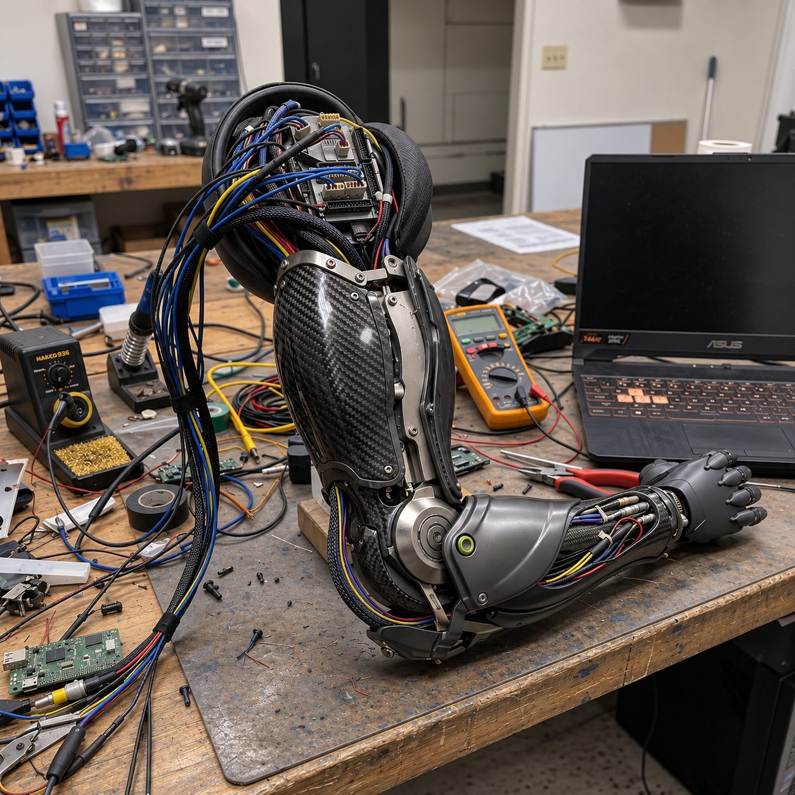
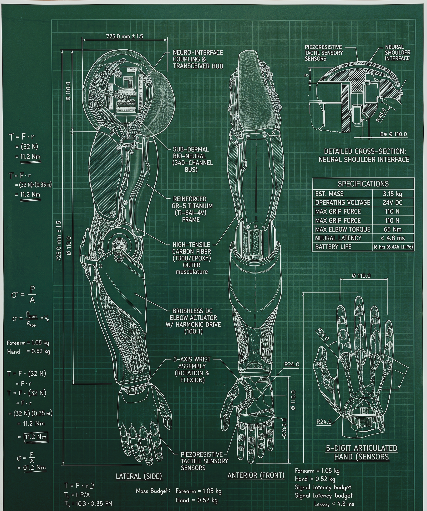
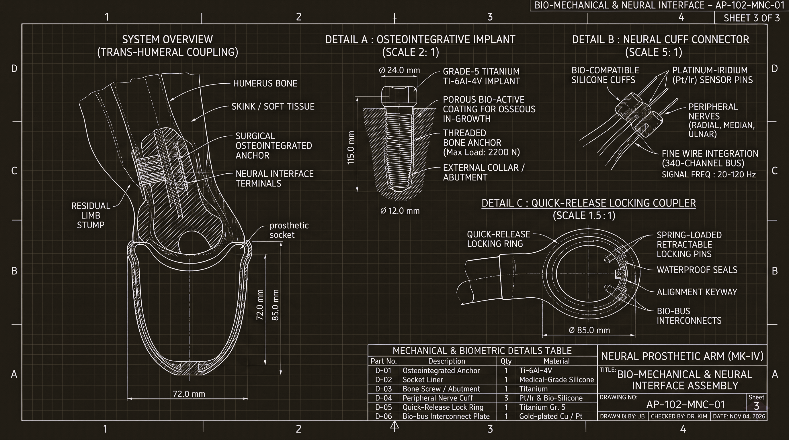
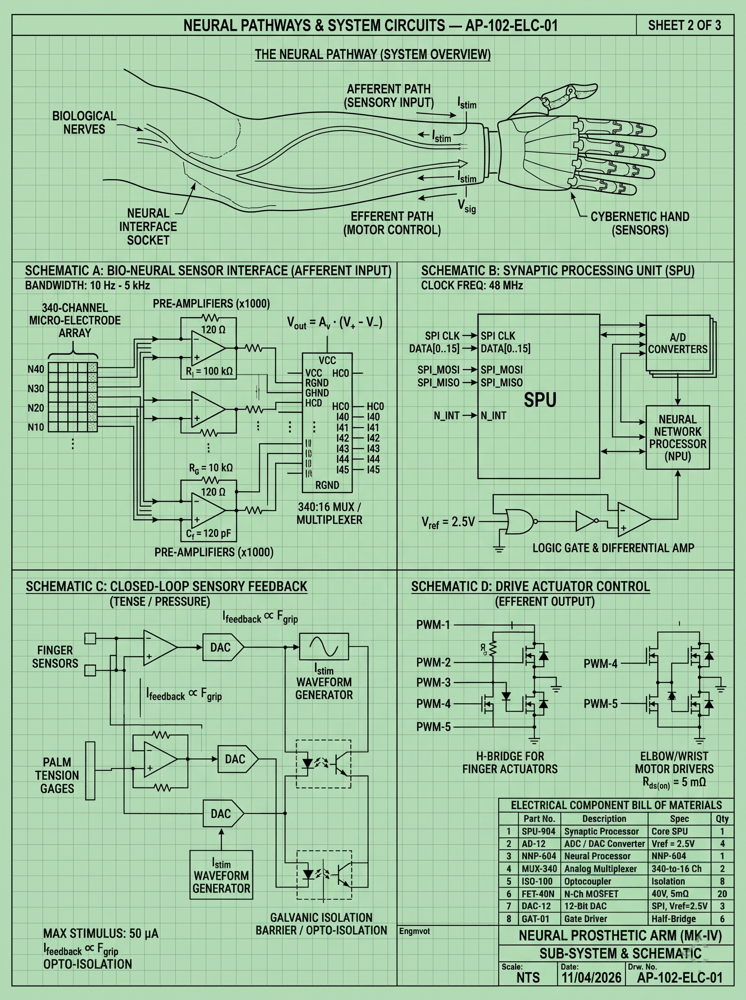
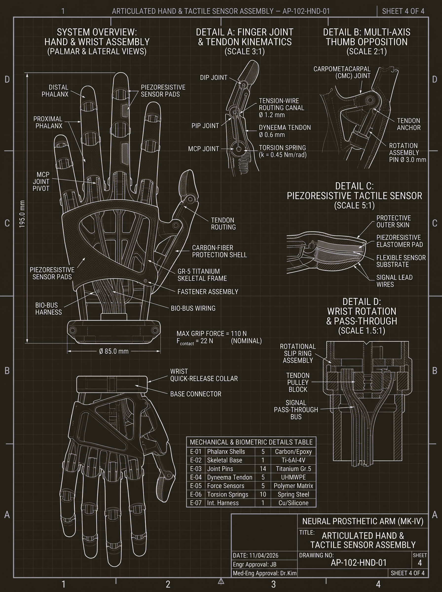
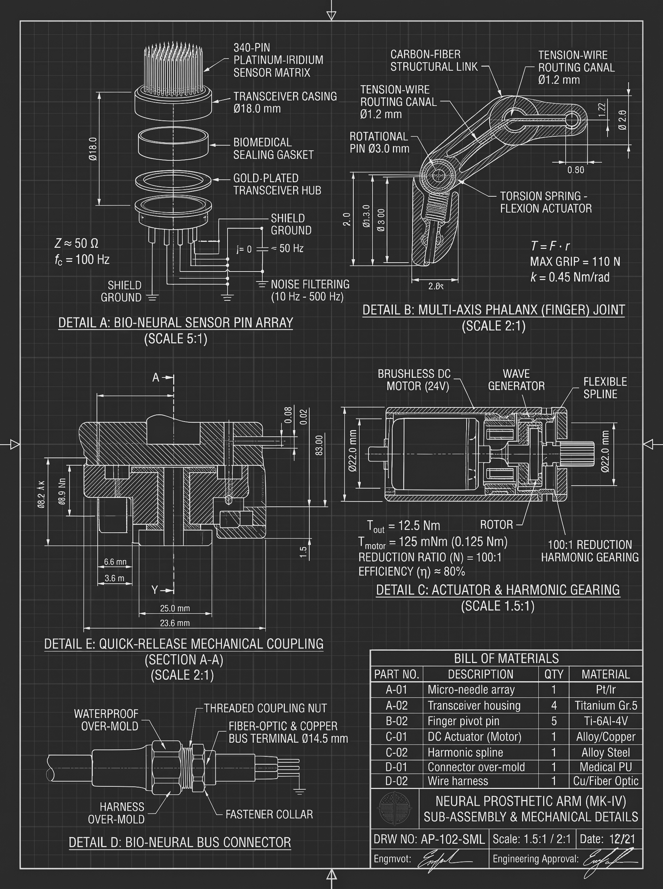
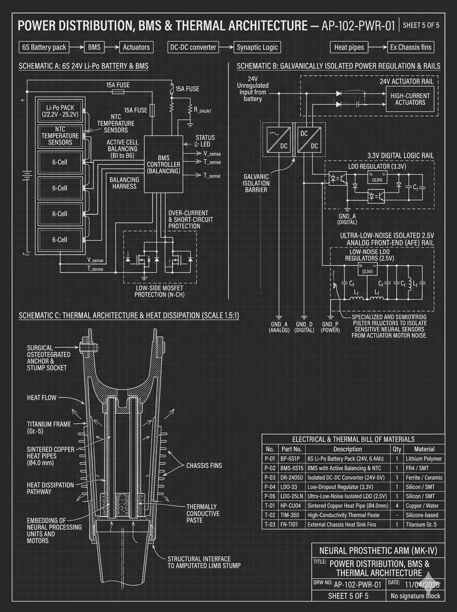

<p align="center">
  
</p>

# AP-102 Neuro-Prosthetic-Prototype (Mk-IV)
### Open-Source Biomechatronic Architecture & Neural Interface Specification

[](LICENSE)
[]()
[]()

The **AP-102 Mk-IV** is a comprehensive engineering specification for a bio-neural cybernetic transhumeral prosthetic arm. Designed around biocompatible high-strength alloys (Grade-5 Titanium) and lightweight structural composites (T300 Carbon Fiber), the system bridges non-invasive or sub-dermal neural intent with multi-axis closed-loop mechanical actuation.

---

## 1. System Architecture

```text
[ Peripheral Nerve / sEMG Bundle ]
               │
               ▼  (Afferent Input: 10 Hz – 5 kHz bandwidth)
┌────────────────────────────────────────────────────────┐
│  Stage 1: Analog Front-End (AFE)                       │
│  - 340-Channel Micro-Electrode Array                   │
│  - Ultra-low-noise Pre-amplifiers (Gain: 1000x)        │
│  - 4th-Order Butterworth Bandpass (20 Hz - 450 Hz)     │
│  - 50 Hz Hardware Notch Filter                         │
└──────────────────────────┬─────────────────────────────┘
                           │  (High-Speed SPI Bus)
                           ▼
┌────────────────────────────────────────────────────────┐
│  Stage 2: Synaptic Processing Unit (SPU / Edge NPU)    │
│  - 150 ms Rolling Windowing (30 ms Stride)             │
│  - Time-Domain Feature Extraction (RMS, MAV, WL, ZC)   │
│  - Temporal Intent Classifier / State-Space Model      │
│  - Processing Latency: < 4.8 ms                        │
└──────────────────────────┬─────────────────────────────┘
                           │  (PWM / CAN-FD Command Stream)
                           ▼
┌────────────────────────────────────────────────────────┐
│  Stage 3: Efferent Actuation & Closed-Loop Control     │
│  - Brushless DC Elbow Actuator w/ Harmonic Gearing     │
│  - Multi-Axis Tendon-Driven Phalanx Finger Joints      │
│  - Piezoresistive Tactile Grip Feedback (0–110 N)      │
└────────────────────────────────────────────────────────┘

```

---

## 2. Mechanical & Kinematic Specifications

| Parameter | Engineered Specification | Verification Metric |
| --- | --- | --- |
| **Gross Limb Mass** | $\le 3.15 \text{ kg}$ | Forearm: $1.05\text{ kg}$, Hand: $0.52\text{ kg}$ |
| **Primary Structure** | Grade-5 Titanium (`Ti-6Al-4V`) | Yield strength $\ge 880\text{ MPa}$ |
| **Outer Musculature** | High-Tensile Carbon Fiber (`T300/Epoxy`) | Impact & torsion containment |
| **Operating Voltage** | $24\text{ V DC}$ (Nominal) | $6\text{s LiPo / LiFePO4}$ battery architecture |
| **Max Elbow Torque** | $65\text{ Nm}$ continuous | 100:1 Harmonic Drive reduction |
| **Peak Grip Force** | $110\text{ N}$ | Dynamic fingertip load cell test |
| **Neural Loop Latency** | $< 4.8\text{ ms}$ | Signal ingestion to PWM actuation |

### Kinematic Equations

* **Joint Torque Requirement:**

$$T = F \cdot r \implies T_{\text{max}} = (32\text{ N}) \cdot (0.35\text{ m}) = 11.2\text{ Nm}$$


* **Tendon Spring Restoring Force:**

$$k = 0.45\text{ Nm/rad}, \quad \text{Flexion Stroke} = 0^\circ \text{ to } 90^\circ$$


* **Yield Stress Safety Factor:**

$$\sigma = \frac{P}{A} \le \frac{\sigma_y}{1.5}$$


---
## 3. Engineering Blueprints & Prototype Gallery

### Physical Hardware Proof-of-Concept
<p align="center">
  
  <br>
  <em>Benchtop calibration harness: Carbon-fiber structural shell, titanium elbow yoke, and 24V bio-bus telemetry routing.</em>
</p>

### Master Blueprint Set (AP-102 Series)

<table>
  <tr>
    <td width="50%" align="center">
      <strong>Sheet 1: System Overview & General Specs</strong><br>
      <a href="docs/assets/blueprints/AP-102-SYS-01.png">
        
      </a>
      <p align="left"><em>Full arm envelope (725.0 mm), center of mass, static moment torque (11.2 Nm), and transhumeral interface.</em></p>
    </td>
    <td width="50%" align="center">
      <strong>Sheet 2: Sub-Assemblies & Mechanical Details</strong><br>
      <a href="docs/assets/blueprints/AP-102-SML-01.png">
        
      </a>
      <p align="left"><em>340-pin Pt/Ir array, 100:1 harmonic strain-wave drive, phalanx joint pivot, and quick-release bus collar.</em></p>
    </td>
  </tr>
  <tr>
    <td width="50%" align="center">
      <strong>Sheet 3: Neural Pathways & System Circuits</strong><br>
      <a href="docs/assets/blueprints/AP-102-ELC-01.png">
        
      </a>
      <p align="left"><em>1000x pre-amp conditioning, SPU/NPU SPI bus routing, optocoupled feedback, and MOSFET H-bridges.</em></p>
    </td>
    <td width="50%" align="center">
      <strong>Sheet 4: Bio-Mechanical & Neural Coupling</strong><br>
      <a href="docs/assets/blueprints/AP-102-MNC-01.png">
        
      </a>
      <p align="left"><em>Transhumeral socket fitting, 2200 N titanium bone anchor, and tri-bundle peripheral nerve cuffs.</em></p>
    </td>
  </tr>
  <tr>
    <td width="50%" align="center">
      <strong>Sheet 5: Articulated Hand & Tactile Sensing</strong><br>
      <a href="docs/assets/blueprints/AP-102-HND-01.png">
        
      </a>
      <p align="left"><em>CMC thumb opposition, piezoresistive fingertip sensors (0–110 N), and 180° wrist slip-ring pass-through.</em></p>
    </td>
    <td width="50%" align="center">
      <strong>Sheet 6: Power Distribution, BMS & Thermal</strong><br>
      <a href="docs/assets/blueprints/AP-102-PWR-01.png">
        
      </a>
      <p align="left"><em>Galvanic isolation barrier, 6S active BMS crowbar, and sintered copper heat-pipes routing to chassis fins.</em></p>
    </td>
  </tr>
</table>

---

## 4. Hardware Bill of Materials (BOM)

| Part ID | Sub-System | Component Description | Material / Standard | Qty | Specifications |
| --- | --- | --- | --- | --- | --- |
| **A-01** | Neural Interface | 340-Channel Micro-Needle Array | Platinum-Iridium (`Pt/Ir`) | 1 | 50 Ω contact impedance |
| **A-02** | Structural | Transhumeral Abutment | `Ti-6Al-4V` (Grade 5 Titanium) | 1 | Max axial load: 2,200 N |
| **B-01** | Elbow Drive | Brushless DC Motor | NdFeB / Copper Wire | 2 | 24V DC, 65 Nm peak torque |
| **B-02** | Gearing | Precision Harmonic Drive | 40Cr Alloy Steel | 1 | 100:1 reduction ratio |
| **C-01** | Digit Linkage | Articulated Finger Structural Shell | T300 Twill Weave Carbon / Epoxy | 5 | Multi-axis joint assembly |
| **C-02** | Tendon System | Ultra-High Tensile Cord ($\varnothing0.6\text{ mm}$) | UHMWPE (Braided Dyneema) | 5 | Tensile rating > 392 N |
| **C-03** | Passive Return | Joint Torsion Springs | Spring Steel | 5 | $k = 0.45\text{ Nm/rad}$ |
| **D-01** | Embedded Core | Dual-Core Real-Time Processor | Silicon (BGA package) | 1 | ESP32-S3 / ARM Cortex-M4 |
| **D-02** | Tactile Sensor | High-Sensitivity Piezoresistive Pad | Carbon Nanotube / Polymer | 5 | 0–110 N dynamic range |
| **D-03** | Interface | Silicone Nerve Cuffs | Medical-Grade Silicone | 3 | Radial, Median, Ulnar |

---

## 5. Development Roadmap

* [x] **Phase 1: Conceptual Schematics & Kinematics Formulation** (Completed via AP-102 Series)
* [x] **Phase 2: Signal Pipeline Proof of Concept** (Python-based EMG DSP & Feature Extractor)
* [ ] **Phase 3: Digital Twin Simulation** (URDF Kinematic Tree imported into MuJoCo)
* [ ] **Phase 4: Physical Sub-Assembly Prototype** (3D-printed index digit with tendon routing)
* [ ] **Phase 5: Embedded Integration** (Firmware running on real-time motor controller)

---

## Citation & Attribution

If you reference this specification, blueprints, or DSP firmware in your research, please cite:

```bibtex
@misc{ap102_neuro_prosthetic_2026,
  author       = {Sourav},
  title        = {AP-102 Neuro-Prosthetic-Prototype (Mk-IV): Open-Source Biomechatronic Architecture & Neural Interface Specification},
  year         = {2026},
  publisher    = {GitHub},
  journal      = {GitHub Repository},
  howpublished = {\url{https://github.com/Velocity07/NeuroProsthetic_Prototype_MKIV}}
}
```

**Standard Format:**
> Sourav. (2026). *AP-102 Neuro-Prosthetic-Prototype (Mk-IV): Open-Source Biomechatronic Architecture & Neural Interface Specification*. GitHub. [https://github.com/Velocity07/NeuroProsthetic_Prototype_MKIV](https://github.com/Velocity07/NeuroProsthetic_Prototype_MKIV)ś